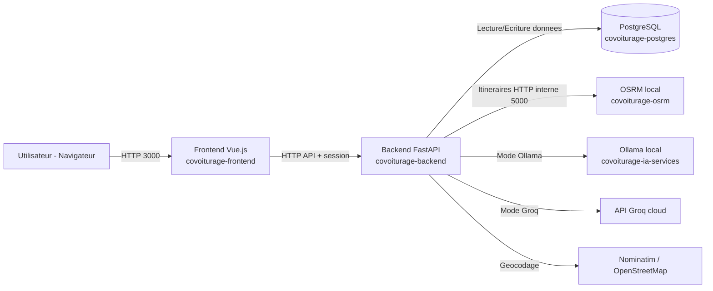
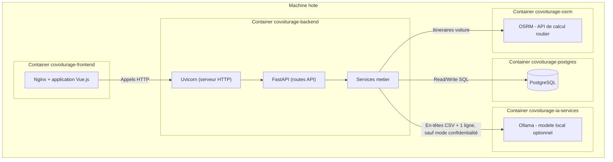
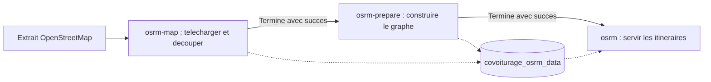

# Architecture Technique

## Vue d'ensemble runtime

- `frontend`: application web utilisateur (Vue.js) servie par Nginx
- `backend`: API HTTP et orchestration metier (FastAPI + Uvicorn)
- `database`: persistance relationnelle (PostgreSQL)
- `osrm`: calcul local des itineraires voiture a partir d'une carte OpenStreetMap
- `osrm-map` et `osrm-prepare`: preparation ponctuelle des donnees OSRM, puis arret
- `ia-services`: inference locale optionnelle pour mapping CSV (Ollama)
- `Groq`: inference cloud utilisee par le demarrage Groq
- `service cartographique externe`: geocodage et geocodage inverse (Nominatim / OpenStreetMap)

## Schema des flux (mermaid)



## Schema de placement conteneurs (mermaid)



Ce schema montre les services permanents. En mode Groq, le conteneur Ollama
est absent et le backend appelle l'API cloud. Les deux conteneurs de preparation
OSRM sont detailles plus bas : ils ne restent pas actifs apres leur travail.

## Arbre d'architecture et roles

```text
/
|-- backend/                     # logique applicative et endpoints HTTP
|   |-- requirements.txt         # dependances Python du backend
|   |-- api/                     # routes, schemas DTO, gestion de session
|   |-- services/                # regles metier (parsing, matching, geocodage)
|   |-- models/                  # entites metier
|   |-- database/                # acces a la base de donnees
|   |-- core/                    # configuration et utilitaires globaux
|   `-- messages.py              # catalogue messages metier
|-- frontend/                    # interface utilisateur Vue.js
|   |-- src/
|   |   |-- api/                 # client HTTP + appels endpoints
|   |   |-- stores/              # etat applicatif et orchestration UI
|   |   |-- pages/               # ecrans
|   |   |-- components/          # composants reutilisables
|   |   |-- router/              # navigation
|   |   `-- assets/              # styles
|   `-- tests/                   # unit + e2e frontend
|-- doc/                         # documentation technique
|-- scripts/
|   |-- start-local.ps1               # demarrage standard avec Groq
|   |-- start-local-ollama.ps1        # demarrage explicite avec Ollama CPU
|   |-- start-local-ollama-gpu.ps1    # demarrage explicite avec Ollama GPU
|   |-- start-local-no-build.ps1      # demarrage Groq sans rebuild
|   `-- stop-local.ps1           # arret des services locaux
|-- docker/
|   |-- docker-compose.groq.yml   # stack complete avec Groq
|   |-- docker-compose.ollama.yml # stack complete avec Ollama
|   |-- docker-compose.gpu.yml    # acceleration GPU Ollama
|   |-- docker-compose.osrm.yml   # preparation et serveur OSRM, inclus dans les deux stacks
|   |-- osrm/
|   |   |-- prepare-map.sh        # telechargement et decoupe de la carte
|   |   `-- build-graph.sh        # construction du graphe routier MLD
|   |-- Dockerfile.backend        # image backend
|   |-- Dockerfile.frontend       # image frontend
|   `-- nginx.conf                # serveur du frontend
|-- backend/services/planning_import_services/
|   |-- planning_import_parser.py # point d'entree import planning
|   |-- csv_ai/                  # import CSV assiste IA (prompts, schemas, debug)
|   `-- ics/                     # import ICS
`-- .env / .env.example          # configuration
```

## Services Docker

- `backend`: build `docker/Dockerfile.backend`, conteneur `covoiturage-backend`, port `${BACKEND_PORT}`
- `frontend`: build `docker/Dockerfile.frontend`, conteneur `covoiturage-frontend`, port `${FRONTEND_PORT}`
- `database`: image `postgres:16-alpine`, conteneur `covoiturage-postgres`, port `5432`
- `ia-services` (mode Ollama uniquement): image `ollama/ollama`, conteneur `covoiturage-ia-services`, port `${OLLAMA_PORT}`
- `osrm`: image `ghcr.io/project-osrm/osrm-backend:v5.27.1`, conteneur `covoiturage-osrm`, port interne `5000` (non publie sur l'hote)
- `osrm-map`: image `debian:bookworm-slim`, conteneur `covoiturage-osrm-map`, tache de preparation sans port
- `osrm-prepare`: image `ghcr.io/project-osrm/osrm-backend:v5.27.1`, conteneur `covoiturage-osrm-prepare`, tache de preparation sans port

### Variantes de demarrage

| Mode | Configuration Compose | Services permanents prevus |
| --- | --- | --- |
| Groq cloud | `docker-compose.groq.yml` | frontend, backend, database, osrm (4) |
| Ollama CPU | `docker-compose.ollama.yml` | frontend, backend, database, osrm, ia-services (5) |
| Ollama GPU | `docker-compose.ollama.yml` + `docker-compose.gpu.yml` | Les memes 5 services, avec GPU pour Ollama |

Les deux configurations principales incluent `docker-compose.osrm.yml`.
Groq est un service externe : il ne cree pas de conteneur local. La variante GPU
modifie Ollama et la configuration du backend, sans ajouter de service.

### Cycle de vie OSRM

Les trois conteneurs OSRM se repartissent la preparation des donnees et leur
utilisation. Ils partagent le volume nomme `covoiturage_osrm_data`.



1. `osrm-map` telecharge un extrait Toulouse depuis BBBike, avec un repli sur
   Geofabrik en cas d'echec du telechargement. Il installe ses outils puis
   decoupe la carte avec `osmium` selon `OSRM_BBOX`.
2. `osrm-prepare` attend la reussite de `osrm-map`, puis execute
   `osrm-extract` (profil voiture), `osrm-partition` et `osrm-customize`.
3. `osrm` attend la reussite de `osrm-prepare`, puis lance `osrm-routed`
   avec l'algorithme MLD. Le backend le contacte sur `http://osrm:5000`.

Au premier lancement, le telechargement et le calcul prennent du temps selon
le reseau et la machine. Aux lancements suivants, la carte est reutilisee si
elle existe et si la zone enregistree correspond a `OSRM_BBOX`. Le graphe est
reutilise si `map.osrm.mldgr` existe et est plus recent que `map.osm.pbf`.
Ces verifications permettent aux taches de preparation de se terminer rapidement.

Un statut `Exited (0)` pour `osrm-map` et `osrm-prepare` est normal : leur travail
est termine. Un code de sortie non nul indique un echec qui bloque la suite
de la chaine OSRM. Ces deux services ont `restart: "no"` ; le serveur `osrm`
a `restart: unless-stopped`.

La separation utilise une image Debian pour les outils cartographiques et
l'image OSRM pour construire et servir le graphe. Les deux taches arretees
ne sont donc pas des serveurs d'itineraires supplementaires.

### Configuration et limites du routage

- `OSRM_BBOX` definit la zone sous la forme `min_lon,min_lat,max_lon,max_lat`.
  La valeur par defaut est `1.10,43.40,1.70,43.82` (Toulouse et sa peripherie).
  Une modification relance la preparation au prochain demarrage Compose.
- `OSM_SOURCE_URL` et `OSM_FALLBACK_URL` permettent de changer les sources.
  La carte existante est reutilisee sur la seule base de sa presence et de la
  zone : changer une URL ne force pas son actualisation et aucune mise a jour
  periodique de la carte n'est configuree.
- `OSRM_URL` configure le client du backend ; sa valeur par defaut est
  `http://osrm:5000`.
- La couverture depend aussi de l'extrait source : decouper une zone plus grande
  ne rajoute pas les donnees absentes de cet extrait.

`backend/services/routing.py` consulte d'abord le cache PostgreSQL
(`routing_cache`), puis appelle OSRM si necessaire. Si OSRM est indisponible ou
ne trouve pas d'itineraire, le service renvoie une estimation a vol d'oiseau,
marquee `estimated: True` et jamais mise en cache. Un prochain appel pourra donc
reessayer OSRM. Le delai maximal d'une requete OSRM est de 5 secondes.

Le backend n'a pas de dependance de demarrage envers OSRM dans Compose : il peut
demarrer pendant la preparation de la carte et utiliser cette estimation.
Les dependances de preparation garantissent l'ordre des etapes OSRM, mais aucun
healthcheck OSRM n'est actuellement configure.

### Donnees persistantes

| Volume nomme | Contenu | Utilisation |
| --- | --- | --- |
| `covoiturage_postgres_data` | Base PostgreSQL, dont le cache des itineraires | database |
| `covoiturage_profile_photos` | Photos de profil | backend |
| `covoiturage_osrm_data` | Carte decoupee, zone enregistree et graphe routier | osrm-map, osrm-prepare, osrm |
| `covoiturage_ollama_data` | Modeles Ollama | ia-services, uniquement en mode Ollama |

Les volumes survivent a un arret ou une recreation des conteneurs. Leur suppression
supprime les donnees correspondantes ; le volume OSRM permet notamment d'eviter
de telecharger et reconstruire la carte a chaque lancement.

## Services externes

OSRM calcule les itineraires localement ; le geocodage reste un appel externe.
Le telechargement initial de la carte OSRM depend egalement d'Internet.

- `Groq` (mode cloud uniquement) : inference pour l'import CSV assiste par IA,
  configuree notamment avec `GROQ_API_KEY` et `GROQ_MODEL`.

- `Nominatim / OpenStreetMap`
- Role: convertir une adresse en coordonnees (`lat/lon`) et faire le geocodage inverse.
- Utilisation: edition de profil, selection d'adresse, positionnement carte.
- Nature: service externe HTTP appele par le backend (non conteneurise dans ce projet).
- Comportement si indisponible: la recherche d'adresse peut echouer ou etre degradee, mais le reste de l'application continue de fonctionner.

## Logs explicites de demarrage

Utiliser le script correspondant au fournisseur:

```powershell
./scripts/start-local.ps1
./scripts/start-local-ollama.ps1
./scripts/start-local-ollama-gpu.ps1
```

Variante Groq sans rebuild:

```powershell
./scripts/start-local-no-build.ps1
```

Le script affiche:
- URL Frontend
- URL Backend API
- URL Health API
- fournisseur et modele IA actifs
- URL Ollama uniquement en mode Ollama
- et l'etat des conteneurs (`docker compose ps`)

Pour voir aussi les taches OSRM terminees et consulter leurs logs depuis la
racine du projet (remplacer le fichier par la variante Ollama si necessaire) :

```powershell
docker compose -f docker/docker-compose.groq.yml ps -a
docker compose -f docker/docker-compose.groq.yml logs --tail=100 osrm-map osrm-prepare osrm
```
