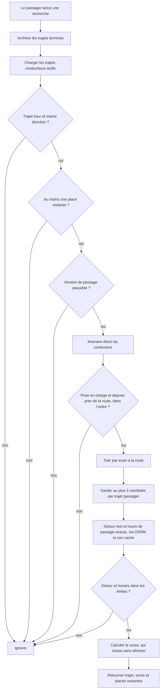

# Algorithme de matching covoiturage

Code source : `backend/services/matching.py` pour le moteur,
`backend/services/routing.py` pour les itineraires et
`backend/database/manager.py` pour les places et les selections.

## Principe

Tout utilisateur peut chercher une place. L'application compare ses trajets de
recherche avec les trajets proposes par les autres (`rides.is_offer`). Un
conducteur convient si sa route passe pres du passager (prise en charge puis
depose), si le vrai detour reste raisonnable et s'il passe au bon moment. Les
regles eliminent, le score ne fait que classer. Un trajet que
l'utilisateur propose lui-meme ne cherche pas de conducteur.

Dans l'onglet « Mes trajets », chacun voit tous ses trajets : il choisit ceux
ou il prend sa voiture, et pour ceux-la consulte les places restantes et
accepte ou refuse les passagers.

La recherche ponctuelle compare un trajet saisi a la main. Dans l'onglet
« Tout mon planning », le passager choisit une semaine de cours (lundi a
vendredi ; par defaut, la semaine du prochain cours). `POST /matches/find` recoit
`week_start`, complete uniquement les trajets manquants des cours de cette
semaine sans supprimer les demandes existantes, puis filtre les trajets du
passager et des conducteurs sur cette periode avant tout calcul d'itineraire.
Les resultats sont groupes par jour : les fleches de l'interface parcourent
les resultats deja calcules, sans relancer la recherche.

## Vue d'ensemble



## 1. Offres et recherches

Il n'y a plus de role exclusif. Chaque trajet porte sa nature :

```text
is_offer = FALSE  -> recherche : je cherche une place (par defaut)
is_offer = TRUE   -> offre : je prends ma voiture
```

Un trajet devient une offre de deux facons : depuis l'emploi du temps, avec le
bouton « Proposer » sur un trajet de cours (`PUT /rides/{id}/offer`) ; ou a la
main, hors emploi du temps, avec le formulaire « Proposer un trajet »
(`POST /rides/offers`). « Annuler ce trajet » (`DELETE /rides/{id}/offer`)
supprime un trajet cree a la main et rend sa nature de recherche a un trajet
de cours. Proposer exige un nombre de places au profil
(`car_seats`, 1 a 4) ; retirer une offre est refuse tant qu'elle a des
demandes en attente ou des passagers acceptes.

Un utilisateur n'est jamais conducteur et passager a la meme minute : il ne
peut pas proposer un creneau ou il a une demande, ni demander une place sur un
creneau ou il propose sa voiture. Les creneaux qu'il propose sont donc exclus
de sa recherche.

## 2. Archivage avant la recherche

Un trajet reste dans `rides` mais passe de `active` a `archived` lorsqu'il est
termine. Comme la base ne stocke pas encore la duree exacte du trajet, la
regle retenue est un delai de trois heures apres `ride_time`.

L'archivage est idempotent et peut etre declenche avant les lectures metier :

```sql
UPDATE rides
SET status = 'archived', archived_at = NOW()
WHERE status = 'active'
  AND ride_time < LOCALTIMESTAMP - INTERVAL '3 hours';
```

Les trajets archives restent consultables dans l'historique, avec leurs
selections, mais ne participent plus au matching.

## 3. Places restantes

Une ligne de `ride_selections` represente une demande de passager (`pending`,
`accepted` ou `rejected`).
Le nombre de places restantes est calcule, et non duplique dans `rides` :

```text
places_restantes = conducteur.car_seats - nombre_de_demandes_acceptees
```

Un trajet complet est exclu avant tout calcul d'itineraire. Il ne coute donc
aucun appel a OSRM et n'apparait pas dans les resultats du passager.
Il reste visible au conducteur afin qu'il puisse consulter tous ses passagers.

## 4. Prefiltres sans appel reseau

Pour chaque paire `(trajet_passager, trajet_conducteur)`, le backend applique
les controles suivants dans cet ordre :

1. Le trajet courant doit etre une recherche (un trajet propose ne cherche pas).
2. L'autre trajet doit etre une offre, d'un utilisateur ayant une capacite valide.
3. Le trajet conducteur doit etre `active` et futur.
4. Il doit rester au moins une place.
5. Le passager ne doit pas avoir deja selectionne ce trajet conducteur.
6. Le passager ne doit pas avoir de demande en attente ou acceptee a la meme date et a la
   meme minute que le trajet conducteur.
7. Les deux trajets doivent avoir le meme sens, `to_campus` ou `from_campus`.
8. L'heure de passage du conducteur, estimee a vol d'oiseau, doit etre
   plausible (tolerance du passager, avec une marge de 15 min ; la
   verification exacte vient en section 4 ter).

Il n'y a pas de filtre sur la distance entre les departs : un conducteur qui
fait 30 minutes de route peut passer devant un passager qui habite a 5 minutes
du campus. Ce qui compte, c'est la route.

## 4 bis. Le passager est-il sur la route ?

Pour chaque candidat, l'itineraire direct du conducteur est calcule (OSRM, mis
en cache). La prise en charge et la depose du passager doivent etre a moins de
`MAX_ROUTE_DISTANCE_KM` de cette route, et la depose doit venir apres la prise
en charge le long de la route (sinon le passager va dans l'autre sens). Un
point a moins de 300 m du depart ou de l'arrivee du conducteur (meme campus)
est considere comme confondu avec lui.

Etre pres de la route ne suffit pas : a 500 m d'une rocade sans sortie, le
detour peut depasser 15 minutes. La proximite sert donc a choisir les
candidats ; c'est le detour reel qui decide. Les candidats sont tries par
ecart a la route, et seuls les `MAX_DETOUR_CANDIDATES` premiers par trajet du
passager passent au calcul du detour.

## 4 ter. Horaires : l'heure de passage

L'heure d'un trajet n'a pas le meme sens a l'aller et au retour :

- aller (`to_campus`) : heure d'arrivee visee (debut du cours) ;
- retour (`from_campus`) : heure de depart (fin du cours).

Le conducteur garde son horaire. Le moteur calcule quand il passe chez le
passager, le long de la vraie route :

- a l'aller, il depose le passager avant son arrivee, de la duree de la fin de
  son trajet ; le passager doit etre depose avant son heure d'arrivee, au plus
  tot `time_tolerance_min` minutes avant ;
- au retour, il prend le passager apres son depart, de la duree du debut de
  son trajet ; le passager doit etre pris apres son heure de depart, au plus
  tard `time_tolerance_min` minutes apres.

La tolerance appliquee est celle du passager : l'heure a laquelle il est
depose ou pris ne concerne que lui, et ce que le trajet coute au conducteur
est deja borne par le detour.

## 4 quater. Voiture partagee et creneaux

- **Plusieurs passagers** : chaque reservation enregistre sa prise en charge,
  sa depose, son heure de passage et son detour (`ride_selections`). Si la
  voiture a deja des passagers acceptes, le detour total de tous les arrets,
  visites dans l'ordre de la route, doit rester sous `MAX_TOTAL_DETOUR_MIN`
  (chaque passager restant sous `MAX_DETOUR_MIN`).
- **A l'acceptation** : plusieurs demandes en attente ont pu etre calculees
  chacune seule. Quand le conducteur accepte, le detour total avec les
  passagers deja acceptes est recalcule ; au-dela de `MAX_TOTAL_DETOUR_MIN`,
  il est averti (`RIDE_DETOUR_TOO_LONG`) et peut accepter quand meme
  (`force=true`).
- **Ce que voit le conducteur** : avant d'accepter, l'heure de passage, si le
  passager monte ou descend en chemin, et le detour.
- **Creneaux** : deux trajets a moins de `SLOT_CONFLICT_MIN` minutes l'un de
  l'autre se chevauchent (8h00 et 8h15, par exemple). On ne peut pas etre
  engage sur les deux, ni etre passager pendant un trajet qu'on propose.

## 5. Score de compatibilite

Le score est compris entre 0 et 100. Il ne sert qu'a classer : les regles
precedentes eliminent deja, et il n'y a pas de score minimum (un seuil
filtrait une seconde fois sur les memes criteres). Le nombre de places est
une condition obligatoire, pas un bonus de score.

### Horaires, 0 a 50 points

A l'aller, etre depose en avance dans la tolerance n'est pas un defaut : 50
points. Au retour, l'ecart est une attente apres le cours : 50 points sans
attente, 0 a la limite de la tolerance.

L'interface n'affiche pas ce score : elle montre le rang (choix n° 1, 2...).

### Detour reel, 0 a 50 points

Le moteur compare :

- l'itineraire direct du conducteur ;
- l'itineraire depart conducteur → prise en charge du passager → depose du
  passager → arrivee du conducteur.

Le temps ajoute est la difference entre les deux durees. Le score diminue
jusqu'au seuil `MAX_DETOUR_MIN`, au-dela duquel le trajet n'est pas propose.

Le passager n'a donc pas besoin d'aller au meme endroit que le conducteur :
s'il est sur sa route, il est depose en chemin, quelle que soit son ecole.
Exemples :

- aller : un conducteur qui va de Castanet a la N7 passe devant l'INSA et peut
  y deposer une etudiante de Ramonville ;
- retour : le detour pour deposer le passager chez lui est compte (avant, le
  depart commun au campus donnait toujours un detour nul) ;
- un point a moins de 300 m du depart ou de l'arrivee du conducteur (meme
  campus) n'est pas ajoute comme etape.

La carte des resultats marque la depose (↓) quand elle differe de la
destination du conducteur.

### Proximite de la route, 0 a 10 points

Bonus qui departage les candidats dont la route passe au plus pres du
passager : 10 points sur la route, 0 a `MAX_ROUTE_DISTANCE_KM`. Le score total
est toujours plafonne a 100.

Le tri final utilise le score decroissant, puis le detour croissant. Si plusieurs
entrees du planning passager correspondent au meme `ride_id`, seule la
meilleure correspondance est retournee.

## 6. Donnees retournees

Chaque match expose notamment :

```text
ride_id
driver_id
driver_name
car_seats
available_seats
score
extra_time_min
route_geometry
```

`ride_id` identifie la proposition a selectionner. `available_seats` est
calcule au moment de la recherche.

## 7. Selection d'un trajet

Le clic depuis les resultats ouvre d'abord une page de recapitulatif avec la
carte, l'horaire, le conducteur, le passager, la compatibilite et les places
restantes. Aucune donnee n'est inseree avant la validation finale.

Le passager connecte demande une place sur un trajet conducteur. Le backend :

1. verrouille la ligne du passager, puis celle du trajet avec `SELECT ... FOR UPDATE` ;
2. verifie que le trajet est une offre active et qu'il n'appartient pas au demandeur ;
3. refuse une demande deja presente pour ce trajet ou cette meme minute, ainsi
   qu'un creneau ou le demandeur propose lui-meme sa voiture ;
4. recompte les demandes acceptees et refuse le trajet s'il est complet ;
5. insere une demande `pending`, sans occuper de place.

Le conducteur voit la demande dans ses trajets et peut l'accepter ou la refuser.
L'acceptation recompte les places sous verrou ; seule une demande `accepted`
occupe une place. Les reservations existantes avant cette evolution restent
acceptees. La contrainte unique sur `(ride_id, passenger_id)` interdit une
seconde demande pour le meme trajet.

L'annulation supprime uniquement la selection appartenant au passager
connecte. Si elle etait acceptee, la place est liberee automatiquement.
Elle est refusee (409, `TRACKING_CANCEL_TOO_LATE`) des qu'une etape du suivi
a ete confirmee : la course a commence, meme si l'appel vient directement de
l'API et non de l'interface.

## 8. Calcul et cache des itineraires (OSRM)

Les itineraires sont calcules par **OSRM**, un moteur de calcul d'itineraires
libre qui tourne en local dans le conteneur `osrm`, sur une carte
OpenStreetMap de Toulouse et sa peripherie. Il n'y a ni cle, ni quota, et un
calcul prend quelques millisecondes.

Le code est decoupe en trois modules :

- `services/routing.py` : point d'entree unique (cache, puis OSRM, puis estimation) ;
- `services/osrm_client.py` : appels HTTP a l'API `/route` d'OSRM ;
- `services/route_estimate.py` : estimation de dernier recours.

Les itineraires directs et avec prise en charge et depose sont enregistres dans
`routing_cache`. Une route connue est reutilisee sans nouveau calcul.

Pour chaque trajet du passager, trois conducteurs au maximum sont evalues. Sans
cache, cela represente au plus trois routes directes et trois detours. Les
filtres d'offre, d'etat, de places, d'horaire et de distance ont tous lieu
avant ces appels.

### Repli quand OSRM est indisponible

Si OSRM ne repond pas (conteneur arrete, carte encore en preparation au premier
demarrage, point hors de la zone couverte), la recherche ne tombe pas en
erreur : le service d'itineraire renvoie une **estimation** marquee
`estimated: true`.

- Distance = distance a vol d'oiseau x 1,3 ; duree = distance / 30 km/h.
- Trace = ligne droite entre les points.
- L'estimation n'est jamais mise en cache : le vrai itineraire sera calcule
  des qu'OSRM repondra de nouveau.
- Les correspondances portent `route_estimated` (et `search_route_estimated`
  pour la recherche rapide) ; le front affiche alors « Itineraire estime » sur
  la carte.

Fiable pour classer les conducteurs, approximative pour les durees affichees :
c'est un filet de securite, pas un mode de fonctionnement normal.

## Option « ladies only »

Option **ponctuelle d'une recherche**, pas un réglage de profil : elle est
transmise à chaque appel (`ladies_only` dans le corps de `POST /matches/search`,
paramètre de requête du même nom sur `POST /matches/find`) et rien n'est
persisté à son sujet. Seul `users.gender` est stocké.

Deux propriétés à garder en tête :

- **Réservée aux utilisatrices.** Le serveur refuse l'option à tout compte dont
  `gender` n'est pas `femme` (403, `MATCHES_LADIES_ONLY_FORBIDDEN`). C'est un
  espace entre femmes, pas un filtre de préférence ouvert à tous. Le front se
  contente de masquer la case : la vérification qui fait foi est côté serveur.
- **Filtre unilatéral.** Il restreint les résultats de *celle qui cherche* ;
  il ne la retire pas des résultats renvoyés aux autres. Rendre le choix
  mutuel supposerait de le persister (par exemple une colonne sur `rides`),
  puisque le moteur doit alors connaître le choix des deux côtés d'une paire
  qu'aucun des deux n'a encore ouverte.

## Configuration

| Variable | Defaut | Role |
|---|---:|---|
| `MAX_ROUTE_DISTANCE_KM` | 2.0 | Ecart maximal entre la route du conducteur et le passager |
| `MAX_TOTAL_DETOUR_MIN` | 20.0 | Detour total maximal avec plusieurs passagers |
| `SLOT_CONFLICT_MIN` | 45 | Ecart en dessous duquel deux trajets se chevauchent |
| `MAX_DETOUR_MIN` | 12.0 | Detour maximal accepte |
| `MAX_DETOUR_CANDIDATES` | 3 | Candidats evalues via OSRM par trajet |
